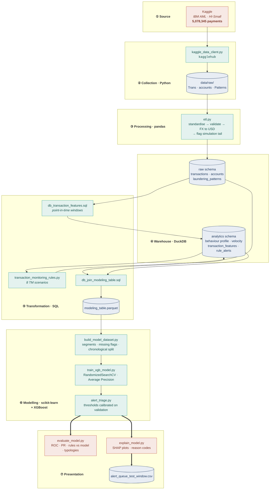
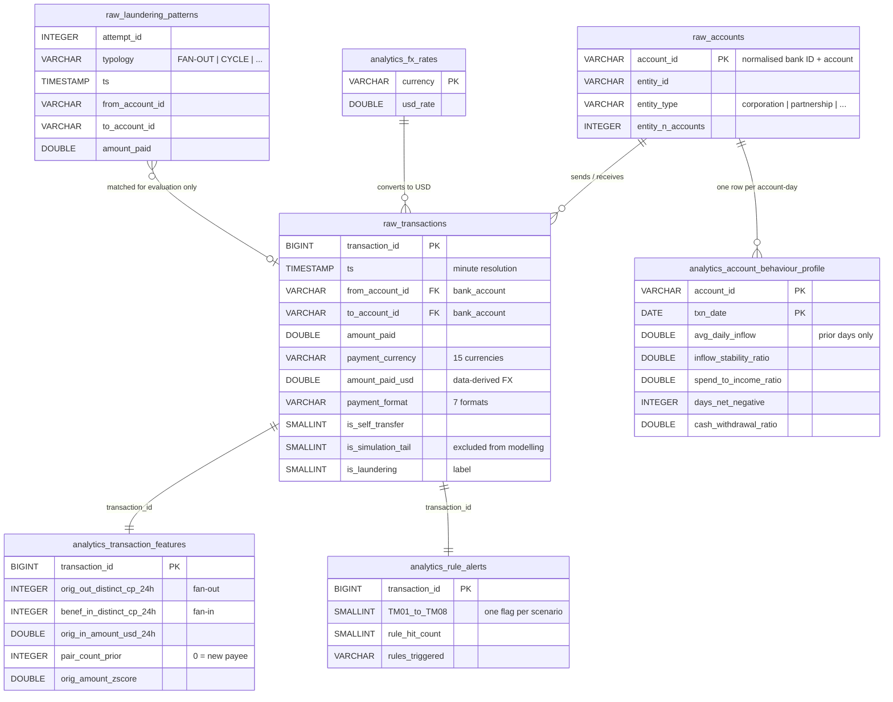
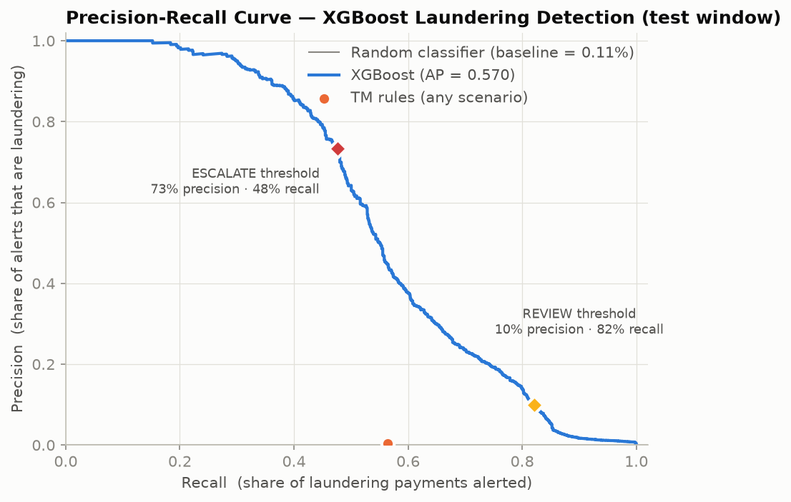
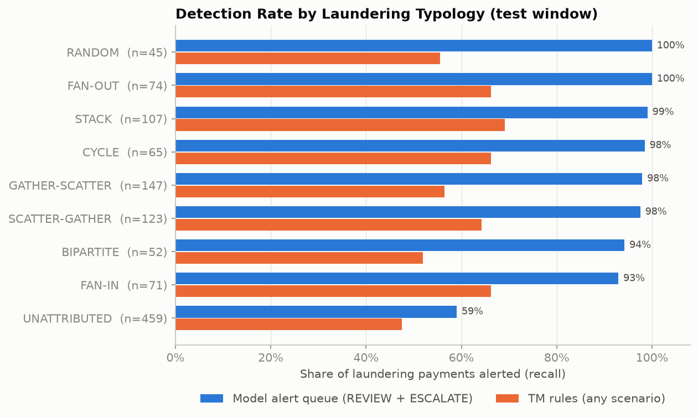
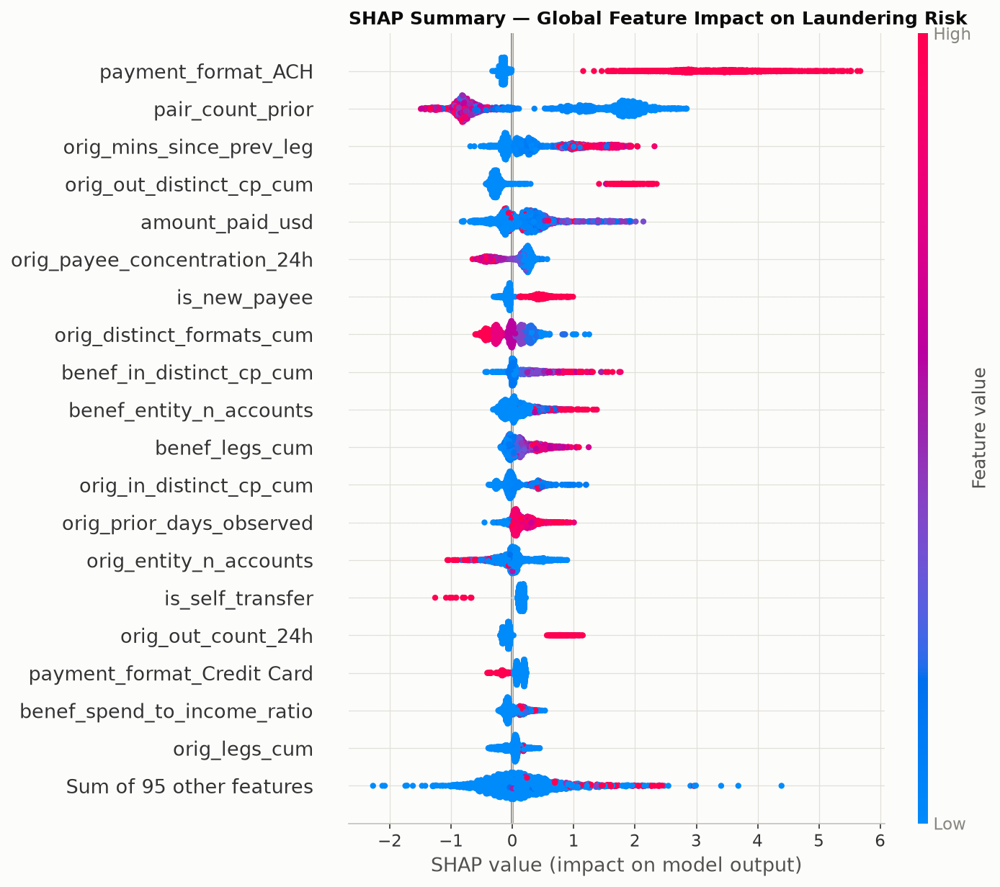
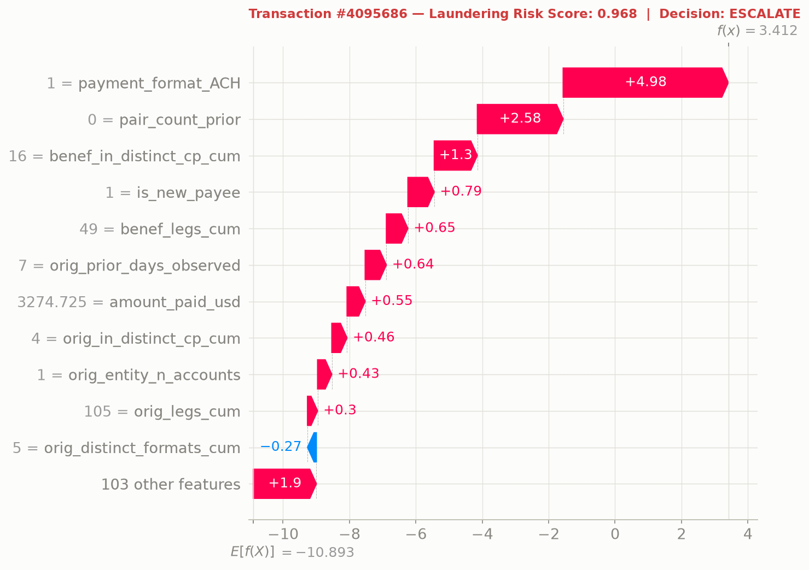

## Table of Content:
1. [Project Background](#project-background)
2. [Business Context](#business-context)
3. [Scope](#scope)
4. [Executive Summary](#executive-summary)
5. [Data Structure and Initial Checks](#data-structure-and-initial-checks)
6. [Analytical Insights](#analytical-insights)
7. [Recommendations](#recommendations)
8. [Issues Encountered](#issues-encountered)
9. [Limitations, Caveats and Assumptions](#limitations-caveats-and-assumptions)
10. [Author](#author)

## Project Background:

Every payment a bank processes is screened for signs of money laundering. Most of this screening is still carried out by rule-based transaction monitoring (TM) systems: fixed scenarios that raise an alert whenever a payment crosses a predefined threshold.

This project is a re-engineering of one of my earlier projects in credit risk scoring. I kept the same statistical approach: rule-based segmentation, behavioural statistics, an XGBoost classifier tuned with `RandomizedSearchCV`, ROC and Precision-Recall evaluation, SHAP explanations and a three-tier decision engine. I then rebuilt the pipeline around a typical AML transaction-monitoring workflow instead of a loan underwriting one.

The main changes from the credit-risk version are the following:
- The unit of prediction is a single payment, not a loan applicant.
- Loan applicant personas become customer risk segments, assigned from each account's behaviour on the day of the payment.
- The five Plaid cash-flow features are re-derived per account, from prior days only.
- The random train/test split is replaced by a chronological one, as an AML model always scores future payments.
- The APPROVE / REFER / DECLINE engine becomes an alert triage policy: CLEAR / REVIEW / ESCALATE.

**[Read the full technical report](reports/final_report.md)**

[Back to top](#table-of-content)

## Business Context:

Transaction-monitoring systems are known to be noisy: rule-based scenarios routinely generate 95–99% false-positive alerts, and every alert costs analyst time to clear.

At the same time, regulators such as the [FCA](https://www.handbook.fca.org.uk/handbook/FCG/3/), [FinCEN](https://www.fincen.gov/resources/statutes-regulations/guidance) and the [FATF](https://www.fatf-gafi.org/en/topics/methods-and-trends.html) expect firms both to detect suspicious activity and to justify why an alert was, or was not, raised.

A statistical risk score layered on top of the rules can help an AML function to:
- Cut alert volumes while catching more laundering.
- Prioritise the highest-risk alerts for experienced investigators.
- Explain every decision with transaction-level reason codes, for auditors and Suspicious Activity Report (SAR) narratives.
- Measure coverage per laundering typology, instead of relying on a single headline metric.

Laundering makes up only 0.10% of the payments in this dataset, roughly 100 times rarer than defaults in the credit-risk project (11.6%). This scarcity shaped most of the modelling decisions described below.

[Back to top](#table-of-content)

## Scope:

This analysis uses the IBM synthetic AML dataset (HI-Small variant), covering 5,078,345 payments between 1 and 18 September 2022, of which 5,177 are labelled as laundering.

The aim is to compare a conventional rules engine against a statistical detection model on the same out-of-time window, and to turn the model's output into an alert queue an investigation team could actually work through.

The investigation focuses on the following key questions:

- How many alerts does a typical rules engine raise, and how many of them are genuine laundering?
- Can a statistical model catch more laundering while raising fewer alerts?
- Which laundering typologies (fan-out, fan-in, cycles and so on) does each approach detect or miss?
- What drives the model's risk score, and can each alert be explained to an investigator?
	- _**Note:** the dataset is synthetic. For more information see **Limitations.**_

This analysis is a proof of concept structured as an end-to-end pipeline: collection, transformation, rule-based screening, modelling, triage and reporting.

[Back to top](#table-of-content)

## Executive Summary:

On an out-of-time test window (8–10 September 2022, 1,015,751 payments), the model-driven alert queue catches **82.2%** of laundering payments with **9,487** alerts. Over the same window the rules engine raises **175,200** alerts and catches only **56.4%**.

In other words, the model raises 95% fewer alerts than the rules, with 27 times the precision and 26 percentage points more laundering caught. The ESCALATE tier alone holds 742 payments at 73% precision, and these account for almost half (47.6%) of all laundering in the window.

The model reaches an Average Precision of **0.571** against a random baseline of 0.11%, and detects 93–100% of every labelled laundering typology, against 52–69% for the rules.

For the full methodology and results, read the **[technical report](reports/final_report.md)**.

[Back to top](#table-of-content)

## Data Structure and Initial Checks:

I collected the data from Kaggle, using the `kagglehub` client to download the [IBM Transactions for Anti-Money Laundering](https://www.kaggle.com/datasets/ealtman2019/ibm-transactions-for-anti-money-laundering-aml) dataset ([Altman et al., 2023](https://arxiv.org/abs/2306.16424)).

I re-engineered the pipeline in Python and SQL and replaced the PostgreSQL database from the credit-risk project with DuckDB: it keeps the same `raw` / `analytics` schemas, needs no database server, and computes the rolling 24-hour features over 10 million account legs in about 20 seconds.

The dataset is composed of three files:
- `HI-Small_Trans.csv`: 5,078,345 payments across 18 days, 15 currencies and 7 payment formats, with an `Is Laundering` label.
- `HI-Small_accounts.csv`: 518,581 accounts with their bank, legal entity and entity type, used as KYC reference data.
- `HI-Small_Patterns.txt`: 370 laundering attempts grouped into 8 typologies, used for evaluation only.

The full Kaggle dataset holds six variants and is about 41 GB uncompressed. I only downloaded the HI-Small variant (~0.5 GB), which is also the benchmark subset used in the IBM paper.

> _**Note:**_ The raw files, the DuckDB database and the modelling table are not published. The pipeline downloads and rebuilds them from Kaggle; the aggregated results are in `reports/tables/` and `reports/metrics.json`.

### Data Quality:

During the data quality checks, I applied the following conditions before running any analysis:

- The raw header repeats `Account` for both the sender and the receiver of a payment. Columns are named explicitly at load time.

- Bank IDs carry leading zeros in the ledger but not in the accounts file. I normalised them so that every payment joins to its KYC record (100% coverage).

- Amounts are recorded in 15 currencies. I converted them to USD with a rate per currency derived from the data itself: the median ratio of amount received to amount paid over cross-currency payments settled in USD.

- After 10 September 2022 the simulator stops generating normal activity and only completes laundering attempts already in progress: 1,108 rows over 8 days, around 60% of them laundering. I flagged these days in the raw layer and excluded them from modelling, as they would otherwise inflate the test results.

- Every behavioural feature is point-in-time: it only uses activity from earlier minutes, plus the screened payment itself. Timestamps have minute resolution and the order of payments within the same minute is unknown, so same-minute activity is treated as not yet observed.

### Pipeline Structure:

A schematic of the pipeline and the DuckDB schema are as follows:



> End-to-end pipeline. Double arrows mark the reporting stage: every published
> artefact (plots, tables, alert queue) is produced from the out-of-time test
> window only. _**Note:** the laundering patterns file is used for evaluation
> and never as a model feature._

### DuckDB schema



> Warehouse schema. Feature tables show a representative subset of their columns
> (the transaction feature table holds 24). The behavioural profile joins to each
> payment on account and date, so a payment only ever sees the account's history
> up to the previous day.

The DuckDB warehouse holds two layers: a `raw` layer with the cleaned ledger, the KYC accounts and the laundering patterns, and an `analytics` layer with FX rates, behavioural profiles, velocity features and the rule alerts. A final SQL join assembles the modelling table: 5,077,237 payments once the simulation tail is excluded.

### Reproducing the pipeline:

```bash
conda env create -f environment.yml
conda activate aml_detection
python run_pipeline.py
```

`python run_pipeline.py --skip-data` re-runs the modelling stages only. Training on the full 3-million-payment training window is memory-intensive, needing around 15 GB of RAM at peak. Setting `NEG_SAMPLE_RATE = 0.2` in `build_model_dataset.py` trains on a 20% sample of legitimate payments instead: about five times faster and much lighter on memory, at a small cost in accuracy (validation Average Precision 0.579 instead of 0.598).

[Back to top](#table-of-content)

## Analytical Insights:

### Insight 1: Rules Engine vs Statistical Model


The rules engine flags 175,200 payments (17.25% of the test window) to catch 645 laundering payments, a precision of 0.37%: more than 99 alerts in 100 are false positives.

The statistical model's alert queue (REVIEW + ESCALATE) flags 9,487 payments (0.93%) and catches 939 laundering payments, at a precision of 9.9% and a recall of 82.2%.

On the chart, the rules engine sits as a single point close to the bottom axis, while the model's curve stays well above it across almost the full range of recall.

> As a note, Average Precision (0.571) is the main metric here rather than ROC-AUC (0.987): with 0.11% of payments being laundering, ROC-AUC looks excellent for almost any model and hides the false-positive problem.

### Insight 2: Alert Triage Tiers

Each payment's risk score is mapped to one of three tiers, with thresholds calibrated on the validation window (never on the test window):

| Tier | Payments | Laundering | Laundering rate | Share of all laundering |
|---|---|---|---|---|
| CLEAR | 1,006,264 | 204 | 0.02% | 17.8% |
| REVIEW | 8,745 | 395 | 4.5% | 34.6% |
| ESCALATE | 742 | 544 | 73.3% | 47.6% |

The ESCALATE threshold was set so that 80% of validation escalations are genuine laundering; on the test window it achieved 73%. This gap between calibration and out-of-time performance is the type of drift a production deployment would need to monitor.

> _**Note:**_ REVIEW is sized so that the queue as a whole captures 80% of validation laundering. In a real programme both targets would be set against analyst capacity and risk appetite.

### Insight 3: Detection by Laundering Typology


The model's alert queue detects 93–100% of every labelled typology, compared with 52–69% for the rules. Fan-out and random patterns are fully detected; fan-in is the hardest labelled typology at 93%.

Around 40% of the laundering in the test window is not attributed to any labelled pattern, and it is the hardest group for both approaches: 59% detected by the model, 47% by the rules.

### Insight 4: What Drives the Risk Score


The five features with the highest impact on the risk score are:
- ACH payments: 87% of laundering in this dataset uses ACH.
- First payment to a new beneficiary (`pair_count_prior = 0`).
- A long gap since the sender's last activity, i.e. a dormant account suddenly reactivating.
- Senders that have already paid many distinct beneficiaries.
- Payment amount, with a non-monotonic effect: risk peaks around USD 10,000 (the US currency-reporting threshold) and drops for very small and very large payments.

Every alert in the investigator queue (`reports/alerts/alert_queue_test_window.csv`) carries its triggered TM scenarios and its top three SHAP reason codes, e.g. `pair_count_prior = 0 (+1.66)`, as a starting point for the investigation narrative.



### Insight 5: Individual Rule Performance

| Scenario | Alerts | Precision | Recall |
|---|---|---|---|
| TM06 New payee, large payment | 2,517 | 14.3% | 31.6% |
| TM02 Rapid movement | 7,502 | 0.91% | 5.9% |
| TM04 Fan-in | 15,329 | 0.84% | 11.3% |
| TM07 Amount spike | 10,459 | 0.59% | 5.4% |
| TM01 Structuring | 16,398 | 0.18% | 2.6% |
| TM03 Fan-out | 104,012 | 0.14% | 12.8% |
| TM05 Cash / crypto | 28,932 | 0.01% | 0.2% |
| TM08 Cross-currency | 3,895 | 0.00% | 0.0% |

The large-payment-to-a-new-beneficiary scenario (TM06) is the only one with useful precision. Fan-out (TM03) generates more than half of all rule alerts, because large legitimate hub accounts trigger it constantly.

Cash/crypto (TM05) caught 2 laundering payments in 28,932 alerts, and cross-currency (TM08) caught none, since no laundering in this dataset converts currency.

> As a note, rule thresholds were set to industry-style defaults (USD 10,000 reporting threshold) and were deliberately not tuned on the labels, so the rules act as an honest benchmark.

[Back to top](#table-of-content)

## Recommendations:

_**For TM scenario owners**_
TM05 and TM08 produce 32,827 alerts between them for 2 genuine cases, and are clear candidates for retirement or redesign on this population. TM03 would benefit from excluding known high-volume hub accounts before counting distinct beneficiaries.

TM06 should be retained: its logic (a large first payment to a new beneficiary) is also the second strongest signal the model learned independently.

_**For alert operations (L1 / L2 teams)**_
A tiered queue lets experienced investigators start from the 742 ESCALATE alerts, where roughly 3 in 4 cases are genuine, while L1 analysts work through REVIEW. Compared with clearing 175,200 rule alerts, this concentrates analyst time where laundering actually is.

_**For model governance**_
Two findings from the build should become standing checks: features must be strictly point-in-time (see **Issues Encountered**), and design choices inherited from earlier projects should be tested rather than assumed. The drift between the 80% ESCALATE precision target and the 73% achieved out-of-time should be monitored as the population changes.

**_Next steps_**
The results of this analysis lend themselves to extension towards customer-level case management: aggregating alerts per legal entity, as investigations and SAR decisions are made on customers rather than single payments. Graph features (cycle detection, PageRank, community membership) and a verified probability calibration of the risk score would be the natural follow-ups.

[Back to top](#table-of-content)

## Issues Encountered:

**_Same-minute activity leaking into the features:_**
The first version of the rolling 24-hour windows included every payment booked in the same minute as the screened one. An independent review of the pipeline flagged this as possible look-ahead bias, and the check confirmed it: 36% of laundering payments share their minute with an ACH self-transfer by the same account, against 1.6% of legitimate payments. The model was partly learning this simulator artefact. Making every window strictly past-only lowered the test Average Precision from 0.537 to 0.419 under otherwise identical settings.
	**_It can be avoided by:_** Defining a point-in-time convention before writing any feature, and checking how differently each feature behaves across the two classes before training.

**_Imbalance treatment inherited from the credit-risk project:_**
The credit-risk model re-weighted the minority class to a balanced prior, and I initially carried this over. An ablation of four strategies, each tuned over the same 15 hyperparameter candidates and selected on validation Average Precision, showed it was the weakest option by a wide margin (0.448, against 0.598 for full data with no re-weighting). Moving to the winning setup raised the test Average Precision from 0.419 to 0.571.
	**_It can be avoided by:_** Treating design choices from previous projects as hypotheses to test, not defaults, especially when the class balance changes by two orders of magnitude.

**_Slow SQL window clause:_**
DuckDB's `EXCLUDE TIES` clause expressed the point-in-time fix in the most direct way, but it ran for over an hour without finishing, against about 20 seconds for the original query. I rewrote the windows to end one minute before each payment and added the payment's own contribution back explicitly, which gives the same result.
	**_It can be avoided by:_** Benchmarking new SQL constructs on a sample of the data before running them on the full 10 million rows.

[Back to top](#table-of-content)

## Limitations, Caveats and Assumptions:

#### _Proof of concept:_
This project is built to demonstrate an AML detection pipeline end to end, not to produce figures for real compliance decisions. It is a static snapshot: every number refers to the HI-Small dataset and the last full pipeline run.

#### _Synthetic data and generator artefacts:_
IBM's simulator produces realistic laundering typologies, but some signals are artefacts of the generator. Laundering is heavily concentrated in ACH payments (the US bank-to-bank transfer network), and wire, reinvestment and cross-currency payments contain none. Feature importances learned from this data would not transfer as they are to a real payment population, and the model weights and thresholds would need re-fitting.

#### _Short observation window:_
Only 18 days of activity are available (10 after removing the simulation tail). Behavioural profiles are therefore measured in days rather than months, and the test window covers about 2.3 days.

#### _Payment-level scoring:_
The model scores individual payments. Real investigations aggregate alerts to the customer or case level over longer periods, and multi-hop patterns such as long cycles are more naturally captured by graph-based approaches.

#### _Risk scores are not verified probabilities:_
The model is trained without re-weighting, so its scores sit on the scale of the real laundering rate, but their calibration as probabilities has not been tested. For this reason the triage thresholds come from validation targets rather than fixed probability cut-offs.

#### _Rule thresholds are untuned defaults:_
The eight TM scenarios use industry-style thresholds and were deliberately not tuned on the labels. A real programme would tune them through above-the-line and below-the-line testing, which would narrow the gap with the model.

[Back to top](#table-of-content)

## Author

<p align="center" width="100%">
  
</p>

<p align="center">
  <strong>Brian Tomassoni</strong><br>
  <em>Business Data Analyst</em>
</p>

<p align="center">
  <a href="https://www.linkedin.com/in/brian-tomassoni">
    
  </a>
  &nbsp;
  <a href="https://github.com/tomasb1805">
    
  </a>
  &nbsp;
  <a href="mailto:tmsbrn2019@proton.me">
    
  </a>
</p>

<p align="center">
  Built as a portfolio project demonstrating machine learning pipeline design,<br>
  financial crime domain knowledge, and production-aware practices.
</p>
